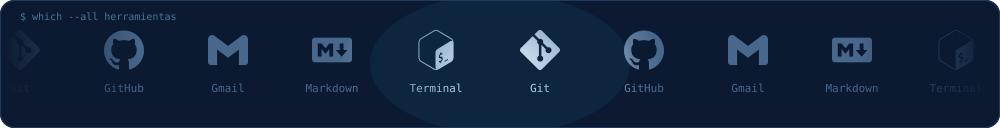

<p align="center">
  
</p>

<p align="center">
  
</p>

<p align="center">
  <a href="https://www.linkedin.com/in/christopher-jovel-307213364/"></a>
  <a href="mailto:christopherjovel7@gmail.com"></a>
  
</p>

<p align="center">
  
</p>

```bash
root@github:~$ ./stats --usuario Chris103105
```
<p align="center">
  
  
</p>

```bash
root@github:~$ ./snake --consumir contribuciones
```
<p align="center">
  
</p>
